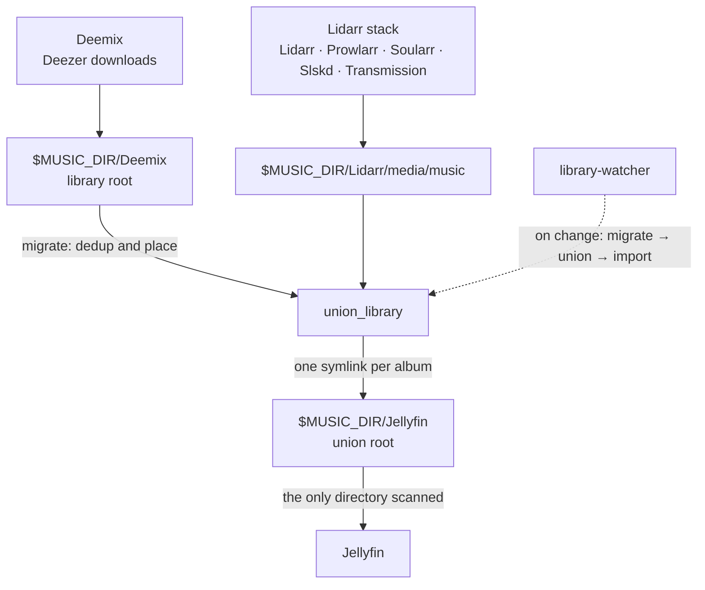

# Home music stack

Deemix downloads music into one library on disk and the Lidarr stack into another. `union_library` merges them into a single deduplicated union root of symlinks that Jellyfin serves, laid out so every song can be browsed by its real artist and album. Playlists are Jellyfin playlists you edit in the Jellyfin UI. A `library-watcher` sidecar polls the source trees and runs the migrate → union → import pipeline automatically when they change ([ADR 0005](docs/explanation/adr/0005-library-watcher-sidecar.md)). Vocabulary: [CONTEXT.md](CONTEXT.md).



## Services (`docker-compose.yml`)

| Service | Image (pinned) | Port | Volumes |
|---|---|---|---|
| `jellyfin` | `jellyfin/jellyfin:12.4` | 8096/tcp (web), 7359/udp (discovery) | `./config` → `/config`, `./cache` → `/cache`, `$MUSIC_DIR/Jellyfin` → `/media` (union root), `$MUSIC_DIR/Deemix` → `/Deemix:ro`, `$MUSIC_DIR/Lidarr` → `/Lidarr:ro` |
| `deemix` | `ghcr.io/bambanah/deemix:v4.8.0` | 6595 (web) | `$MUSIC_DIR/Deemix` → `/downloads`, `./deemix-config` → `/config` |
| `library-watcher` | built from `docker/library-watcher/` (`python:3.13.18-alpine` + git) | — | repo → `/tools:ro`, `$MUSIC_DIR` → `$MUSIC_ROOT` (`/music`) |
| `lidarr` | `ghcr.io/hotio/lidarr:latest` | 8686 (web) | `./lidarr` → `/config`, `${DATA_DIR}` → `/data` |
| `prowlarr` | `ghcr.io/hotio/prowlarr:latest` | 9696 (web) | `./prowlarr` → `/config`, `${DATA_DIR}` → `/data` |
| `flaresolverr` | `ghcr.io/flaresolverr/flaresolverr:latest` | 8191 | stateless — tmpfs `/tmp` for browser profiles |
| `soularr` | `mrusse08/soularr:latest` | 8265 (web) | `./soularr` → `/data` (holds `config.ini`), `${DATA_DIR}/slskd/{downloads,incomplete}` |
| `slskd` | `slskd/slskd` | 5030 (web), 5031 (https), 50300 (slsk listen) | `./slskd` → `/app`, `${DATA_DIR}/slskd/{downloads,incomplete}`, `${DATA_DIR}/media` → `/data:ro`, `$MUSIC_DIR/Deemix` → `/deemix:ro` |
| `transmission` | `lscr.io/linuxserver/transmission:latest` | 9091 (web), 51413 (t/u peer) | `./transmission` → `/config`, `${DATA_DIR}/torrents` → `/data/torrents` |

`jellyfin`/`deemix`/`library-watcher` run as uid/gid 502; the Lidarr stack runs as `PUID`/`PGID` from `.env` (502:20 on this host — FlareSolverr ignores them, its image uses a fixed user). `$MUSIC_DIR` (`.env`) is the host tree the Deemix/Lidarr/Jellyfin folders live under. `cache/` and `.env` are git-ignored, as is almost all of `config/` (db, metadata, logs), `deemix-config/` (credentials, queue, logs — they used to live in the music library), and the Lidarr stack's app dirs (`lidarr/`, `prowlarr/`, `slskd/`, `soularr/`, `transmission/` — runtime state + secrets). The small settings files are tracked so changes are visible in diffs: `config/config/*.xml`, `config/root/`, `config/plugins/configurations/`, `deemix-config/config.json`, `soularr/config.ini.example`, `slskd/slskd.yml.example`. Secrets never live in tracked files — they come from `.env` (see [docs/reference/lidarr-stack.md](docs/reference/lidarr-stack.md#secrets-layout)).

```bash
docker compose up -d                  # start everything (or name services to start a subset)
docker compose stop jellyfin          # e.g. before moving files
docker compose logs -f deemix
```

## Tools

Three stdlib-only Python packages live in this repo; run them from the repo root.

| Tool | Command | What it does |
|---|---|---|
| `reorganize_playlists` | `python3 -m reorganize_playlists <cmd>` | `migrate` dedups/places loose tracks, `import` merges Deemix `.m3u8`s into Jellyfin playlists, `export`, `retag`, `rollback` |
| `union_library` | `python3 -m union_library` | Rebuilds the union root's symlinks to match the source trees |
| `library_watcher` | runs as the `library-watcher` service | Polls the source trees and runs migrate → union → import on change |

## Workflow: download → import

1. Open Deemix at http://localhost:6595 and download playlists (or add an artist in Lidarr — see [add-music](docs/how-to/add-music.md)). Tracks land straight in album folders, and one `<Playlist>.m3u8` is written at the library root.
2. `library-watcher` takes it from there: once the source trees settle it runs `migrate` (dedups and places loose tracks) → `union_library` (refreshes the union root) → `import`. To run the import by hand instead:
   ```bash
   python3 -m reorganize_playlists import
   ```
   It scans Jellyfin and waits for the scan to finish. It appends songs that are new on Deezer to the matching Jellyfin playlist without undoing your edits, and reports songs Deezer dropped. It archives `errors.txt`/`cover.jpg` and uploads the cover, moves the playlist file out of the library, exports all playlists and the inventory, and commits to the library's git repo (never pushed).

## Documentation

The docs follow the [Diátaxis](https://diataxis.fr/) framework — see [docs/README.md](docs/README.md) for the full map.

| Quadrant | Contents |
|---|---|
| **How-to** ([docs/how-to/](docs/how-to/)) | [Setup](docs/how-to/setup.md), [wiring the Lidarr stack](docs/how-to/wire-lidarr-stack.md), [adding music](docs/how-to/add-music.md), the [union-root cutover](docs/how-to/cut-over-union-root.md), the [one-off migration](docs/how-to/migrate-library.md), [upgrading pinned images](docs/how-to/upgrade-images.md) |
| **Reference** ([docs/reference/](docs/reference/)) | [Library layout rules](docs/reference/library-layout.md), [key settings](docs/reference/settings.md), [`reorganize_playlists`](docs/reference/reorganize_playlists.md), [`union_library`](docs/reference/union_library.md), [Lidarr stack](docs/reference/lidarr-stack.md), [CONTEXT.md](CONTEXT.md) |
| **Explanation** ([docs/explanation/](docs/explanation/)) | [Architecture](docs/explanation/architecture.md), [ADRs](docs/explanation/adr/), [specs](docs/explanation/specs/), [research notes](docs/explanation/research/), [retired `dedup_music`](docs/explanation/dedup_music.md) |
| **Tutorials** | none yet — [setup](docs/how-to/setup.md) is the closest to a first-run walkthrough |

## Developing

```bash
python3 -m unittest                         # full suite
python3 -m unittest tests.test_import       # one file
.venv/bin/mypy                              # strict typecheck (python3 -m venv .venv && .venv/bin/pip install mypy)
```

Tools are stdlib-only; keep them that way. Test through the `main(argv, fakes)` seams described in [AGENTS.md](AGENTS.md).
